# 👋 Welcome to my GitHub

I'm a **Frontend Engineer** who enjoys finding practical solutions to real user problems.

My main stack is **React, Next.js, JavaScript, and TypeScript**. I've also built backend APIs with **Spring Boot**, worked with relational databases, and explored data processing with Spark.

## 🛠 Skills

**Languages**

**Frontend & State**

**Styling**

**Backend & Database**

**Infrastructure & Data**

## 🚀 Featured Projects

| Project | Description & Contributions |
| --- | --- |
| **[DevLink](https://github.com/SSAFY-URAYAHA/DevLink_server)** | Agent-based developer collaboration service. Worked on React frontend, Spring Boot authentication and Agent APIs, and PostgreSQL data integrity. |
| **[On:마음](https://github.com/ghida5130/on-Maeum)** | Power-usage-based safety monitoring service. Developed accessible React interfaces and worked on large-scale data preprocessing with HDFS and Spark. |
| **[Meleti](https://github.com/ghida5130/meleti)** | Reading tracker and 3D book viewer using Next.js and Three.js. Optimized on-demand rendering and resource usage. |
| **[Lumos](https://github.com/ghida5130/lumos-frontend)** | Night-tourism discovery service. Built Vue interfaces, Spring Boot signup API, and improved database modeling. |
| **[Gordi](https://github.com/ghida5130/gordi)** | Virtual fitting and collaborative tier-making experience. Implemented real-time cursor sharing for dynamic UI layouts. |
| **[MilliUlsan](https://github.com/ghida5130/milliUlsan)** | Customizable local-information dashboard. Built reusable modules and reduced unnecessary API requests through server-side caching. |

## 📚 Experience & Activities

- **삼성 청년 SW·AI 아카데미 (SSAFY), 15기 Java반:** Java, Spring Boot, databases, and team-based projects.
- **AIS Software & Startup Club, Daegu University:** Organized technology seminars and project reviews. Participated in projects and competitions, with **15 awards during university**.
- **Local AI Makers Lab:** Worked with a social enterprise on an AI-powered B2B collaboration service; received a **second-place award**.

## 📊 Languages in My Public Repositories

<!-- Generated by .github/workflows/profile-cards.yml -->
<picture>
  <source media="(prefers-color-scheme: dark)" srcset="./assets/languages.dark.svg" />
  
</picture>

> This card reflects public repository code volume, not language proficiency.

## 🔗 Links

